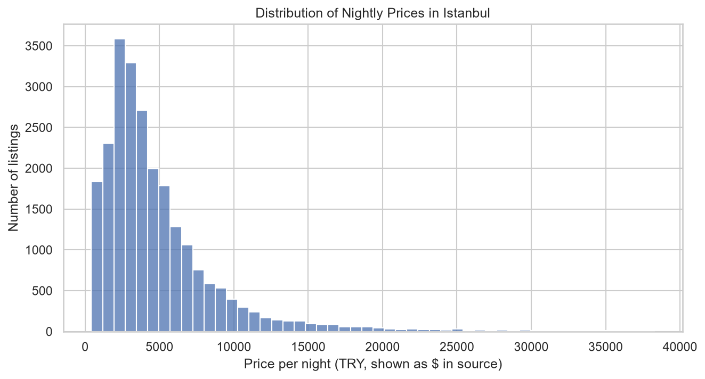
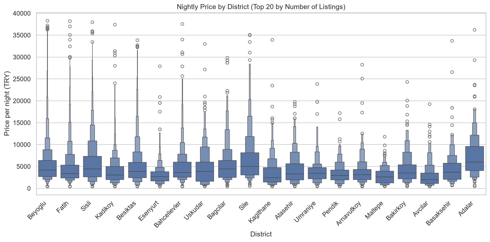
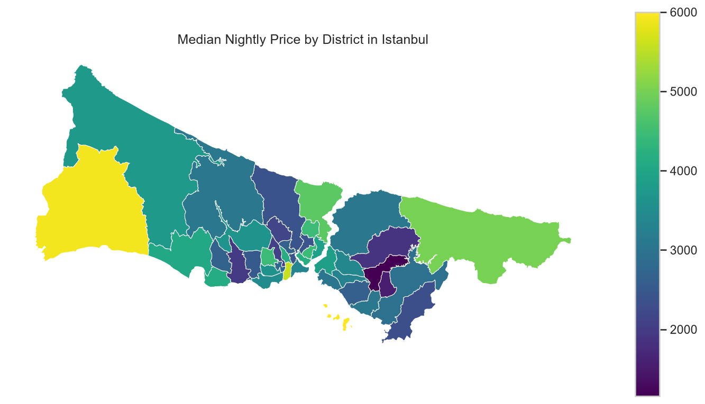

# Istanbul Airbnb Analysis
Data cleaning and exploratory analysis of Airbnb listings in Istanbul using Python (pandas, seaborn, geopandas).

## Data

- **Source:** [Inside Airbnb](https://insideairbnb.com/get-the-data/) (Istanbul, `listings.csv.gz`, `neighbourhoods.geojson`)
- **Snapshot date:** 25 September 2026
- **Size:** 27,232 listings, 90 columns
- **Note:** Prices appear to be in Turkish Lira (TRY), although the source file shows them with a `$` sign.

## Cleaning steps

1. Converted the `price` column from text (e.g. `"$4,736.32"`) to numbers and checked it against the ready-made numeric column.
2. Removed listings with missing prices (about 2,700 listings).
3. Removed the lowest and highest 1% of prices. The maximum price was about 5 million per night, which distorted the average.
4. Kept 22 relevant columns out of 90 (dropped empty columns, URLs and other unused fields).
5. Saved the cleaned data as `data/listings_clean.csv`.

Result: 24,065 listings. The median price barely changed (3,710 → 3,708), while the mean dropped from 6,022 to 4,896.

## Charts

### Price distribution


### Price by district


### Median price map


## Key findings

- Prices are right-skewed: most listings are cheap or mid-priced, a few are very expensive, so the **median** is a better measure than the mean.
- Beyoğlu, Fatih and Şişli hold more than half of all listings. Beyoğlu alone has 6,852.
- Among the 20 districts with the most listings, the highest median prices are in Adalar (6,000), Şile (5,000), Şişli (4,459) and Bağcılar (4,458).
- The lowest medians are in Avcılar (1,982), Kağıthane (2,443) and Maltepe (2,600).
- Adalar and Şile have fewer listings (212 and 368), so their medians are less certain than Beyoğlu's.

## Limitations

- District comparisons cover only the 20 districts with the most listings.
- Prices are asking prices, not confirmed bookings.
- Removing the top and bottom 1% is a judgment call, not a fixed rule.

## How to run

```
git clone https://github.com/mustafaemreyavuz1/istanbul-airbnb-analysis.git
cd istanbul-airbnb-analysis
pip install -r requirements.txt
jupyter notebook
```

Open `notebooks/01_cleaning.ipynb` and run all cells.
